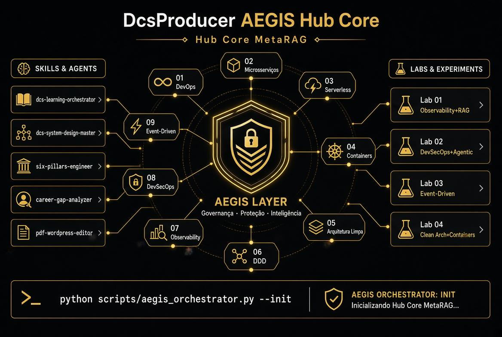

# DcsProducer® AEGIS OS — Meta Global AI Developer Hackathon 2026




> **Governance · Protection · Intelligence** — A production OS layer above any stack that governs GenAI workloads with **fail-closed** security.

**Live demos (no mockups):**
- Core Hub AEGIS: https://core-hub-aegis.vercel.app/
- MetaRAG Hub: https://dcsproducer-hub-pqj9.vercel.app/
- Public architecture case (fail-closed ADR): https://github.com/producerdcs-cpu/impact-ai-engineer-school/tree/main/case-publico
- LinkedIn evidence: 
https://www.linkedin.com/mwlite/profile/in/dcs-producer-78b075415/recent-activity
---

## Dual architecture

### 1. L0–L5 linear (production stack)

| Layer | Role |
|-------|------|
| **L0** | Infrastructure — cloud, on-prem, containers, serverless |
| **L1** | **AEGIS Layer (kernel)** — gate, security, observability, traceability (`aegis_orchestrator.py --init`) |
| **L2** | 9 Pillars + **MetaRAG Hub** — vocabulary + dynamic corpus + RAG |
| **L3** | Labs & evidence — Lab 01–04 (Observability+RAG, DevSecOps+Agentic, Event-Driven, Clean Arch) |
| **L4** | Skills & agents — `six-pillars-engineer`, learning-orchestrator, system-design-master |
| **L5** | Experience & commercial — proposals, contracts, dashboard, white-label |

### 2. Circular Hub Core (runtime governance)

- **Center:** AEGIS LAYER — Governance · Protection · Intelligence  
- **Ring:** 9 pillars (DevOps → Event-Driven)  
- **Left:** Skills (`six-pillars-engineer`, …)  
- **Right:** Labs 01–04  
- **Command:** `python scripts/aegis_orchestrator.py --init`

See also: `architecture/dcsproducer-aegis-os-high-level.md` and `docs/docsaegis-ecosystem-diagram.png`.

---

## Hackathon innovation — Meta Model API

1. **Llama + Llama Guard at L1 gate** — fail-closed before MetaRAG / tools run  
2. **`six-pillars-engineer` skill** — injects engineering vocabulary; prompt optimization (token cost discipline)  
3. **Live MetaRAG Hub** — dynamic corpus at [dcsproducer-hub-pqj9.vercel.app](https://dcsproducer-hub-pqj9.vercel.app/)  
4. **Field flow (Brazil SST):** PDF contract/PGR → orchestrator → optimize prompt → RAG → Guard → checklist + proposal + QR audit trail  

**Related public evidence (sanitized):** [ADR-001 fail-closed / retrieval untrusted](https://github.com/producerdcs-cpu/impact-ai-engineer-school/blob/main/case-publico/docs/ADR-001-fail-closed.md) — same principles as L1 gate.

---

## Quick start

```bash
git clone https://github.com/producerdcs-cpu/dcsproducer-aegis-hub-core.git
cd dcsproducer-aegis-hub-core
python -m venv venv && source venv/bin/activate   # Windows: venv\Scripts\activate
pip install -r requirements.txt
cp .env.example .env   # set META_API_KEY when available

python scripts/aegis_orchestrator.py --init
python scripts/aegis_orchestrator.py --intent "Analyze SST contract and draft NR-35 checklist + commercial proposal" --pilar "08 DevSecOps"
```

---

## Repo map

```
README.md
requirements.txt
.env.example
scripts/aegis_orchestrator.py
architecture/
docs/
skills/six-pillars-engineer/
skills/dcsproducer-aegis-hub-core/
HACKATHON-SUBMISSION.md   ← portal copy + checklist
```

---

## Builder

**DcsProducer®** — Software Engineering + Safety (SST) + Operations  
📍 Campo Grande / Corumbá, MS — Brazil  
Hubs: [core-hub-aegis](https://core-hub-aegis.vercel.app/) · [MetaRAG](https://dcsproducer-hub-pqj9.vercel.app/)

*For Meta judges:* built from real field operations (safety docs, logistics), not a weekend toy — governance layer for how developers should consume Meta Models.

---

© 2026 DcsProducer® · Meta Global AI Developer Hackathon 2026
